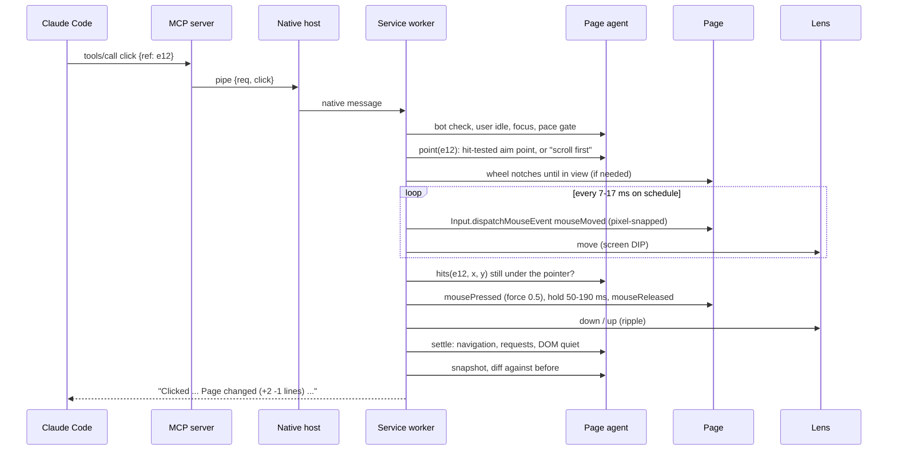
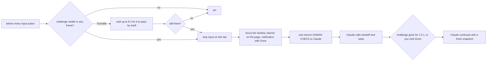

# Browzie: architecture of a human-paced CLI-to-Chrome control loop

Browzie lets a Claude Code session use your everyday Google Chrome the way a person would: a visible
virtual cursor moves to things and clicks them, keys are pressed as real key events, pages are
scrolled with the mouse wheel, and every bot check is handed to you. The transport between
Claude Code and the browser is as fast as a local pipe allows (2 ms round trip).

Input runs at one of three paces, chosen with `BROWZIE_PACE`:

- `fast` (default): short curved moves of 45 to 250 ms, real button and key events, and text
  over 40 characters committed in word chunks.
- `brisk`: a practised user, still inside human ranges.
- `human`: a careful person, about a second per click and key-by-key typing at a human rhythm.
  The footprint test (section 8) measures this profile.

This document is the design. Everything marked "measured" was measured on a Windows 11 machine
(Chrome 155, 125% display scaling) while building it; the test that proves each claim is named
next to it.

---

## 1. Requirements and how each is met

| Requirement | Design answer | Proof |
|---|---|---|
| Fast round trips | Zero-dependency local chain: MCP stdio, a named pipe, native messaging. Compact text snapshots and diffs instead of screenshots. | `npm run bench`: 2 ms round trip, 4 ms snapshot |
| No API keys | Claude Code's own login is the model. Browzie never calls a model. | nothing to configure |
| Your existing browser authentication | Runs inside your normal Chrome profile as an extension. No relaunch, no flags, no copied cookies. | design |
| Visible virtual cursor driven by Claude | Native click-through overlay draws the cursor exactly where Chrome receives the pointer events. | `npm run lens-check`: 0.00 px error |
| Invisible footprint, priority over speed | No automation flags, nothing injected into pages, only real input events, human motion and timing. | `npm run footprint`: 22 of 22 checks |
| Strictly human-paced input | Fitts' law movements, log-normal key timing, wheel notches, think time, per-site caps. | `test/human.test.js` |
| CAPTCHAs routed to you | Detected in every frame; input to that tab stops; you get a notification and a banner; Claude waits. | e2e "bot checks" test |
| No fingerprint or IP tricks | None exist in the code: no UA, navigator, WebGL, canvas, timezone or proxy changes. | section 8 |
| Coexists with other tools | Its own names, pipe, registry key and extension id; no TCP port at all. | section 10 |

Non-goals, on purpose: defeating anti-bot systems, solving or bypassing CAPTCHAs, hiding the
browser's identity, rotating IPs, running headless against real sites. Browzie makes automation
look like what it actually is underneath, a person-paced session in a real browser, and it
removes the artificial tells that tools add. It does not lie about anything.

---

## 2. What the measurements showed before any design decision

The baseline was a plain DevTools-protocol driver: Chrome started with a debugging port.

**A debugging-port browser is visible to sites.** bot.sannysoft.com reports
`WebDriver: present (failed)` for it, because a debugging-port launch sets
`navigator.webdriver = true`. Browzie therefore never launches or flags Chrome.

**What a page can see of input.** A probe page recorded every event. A real mouse crossed it
before the plain driver clicked, so both are in the same log:

| Signal a page can read | A real mouse | Plain CDP click |
|---|---|---|
| Path to the target | about 25 moves, 6 to 19 ms apart, curved | one 423 px jump |
| mousedown, mouseup, click | separate times | the same millisecond |
| `pressure` on pointerdown | 0.5 (spec value for a mouse button) | 0 |
| Coordinates at 125% | on the physical pixel grid (clientX 843.2) | integers, off the grid 4 times in 5 |
| `screenX - clientX` | correct | correct (not a tell) |
| `isTrusted` | true | true |

Conclusion: DevTools input events themselves are sound (trusted, correct screen coordinates).
The tells come from how tools use them. Browzie keeps the trusted input path and fixes the use.

**Chrome 155 facts that shaped the build.**

- Branded Chrome ignores `--load-extension`, so the extension is installed once with "Load
  unpacked". Automated tests use Chrome for Testing, which still accepts the flag.
- `Chrome_RenderWidgetHostHWND` is no longer the page area (it is a hidden 1296x56 window), so
  the overlay cannot find the viewport through window handles. Browzie calibrates from the events
  instead (section 7).
- `chrome.runtime.getFrameId(iframe)` returns -1 for out-of-process (cross-site) iframes. Browzie
  resolves those through the browser's frame tree (section 4.4).
- Chrome shows "Browzie started debugging this browser" about 0.7 s after the first attach,
  asynchronously, and the page in view shrinks by its height. Browzie waits for it on a new window
  before loading any page.
- A brand-new window settles its size while the first page loads, with or without the debugger
  attached (measured both ways). Pages after the first see no resize at all.
- When the workstation is locked, renderers acknowledge input once per 100 ms. A loop that
  waits for each acknowledgement stretches a 0.5 s movement to 3.5 s; Browzie replays on schedule
  instead (section 5.3).
- Under CPU load a late keydown let its keyup follow 3 ms behind (a 3 ms key press, which no
  finger makes). Real input carries the time it physically happened; Browzie now stamps every
  event with its planned time (the DevTools `timestamp` field), and three browsers competing
  for the CPU all passed the footprint test with a shortest key hold of exactly the planned 42 ms.
- The footprint test later caught a 1 ms key hold that was not load at all: the typing model let
  the same key go down again before its previous press was up ("ll" with a short gap), which no
  keyboard can do. The model now releases a physical key before pressing it again (`1` and `!`
  share one key).
- YouTube gives `<html>` and `<body>` zero height and sets overflow on them; a rule that skips
  zero-size clipping boxes therefore hid the whole page from snapshots. The root and body never
  clip (their overflow applies to the viewport), so they are now always walked.

---

## 3. Architecture

```
  Claude Code CLI  (your claude.ai login: the model)
        |  MCP, JSON-RPC 2.0 over stdio, one server process per Claude Code session
        v
  Browzie MCP server            server/server.js
        |  named pipe \\.\pipe\browzie-<pid>-<random>, token from %LOCALAPPDATA%\Browzie\hosts\<pid>.json
        v
  Browzie native host           host/host.js  (started by Chrome through native messaging)
        |  stdin/stdout, 4-byte length + JSON                 \  JSON lines
        v                                                      v
  Browzie extension (MV3) in your everyday Chrome         Browzie Lens  lens/browzie-lens.exe
   service worker   extension/sw.js                      click-through overlay windows:
     sessions, windows, tab groups                         cursor, viewport frame, banner
     input executor + human model (lib/human.js)           watches GetLastInputInfo
     safety gates, bot-check handoff
     chrome.debugger: Input domain (+ dialogs)
   page agent       extension/agent.js
     content script, ISOLATED world, read-only
     snapshots, refs, hit tests, geometry, bot checks
        |
        v
  Web pages: receive only real, trusted input events; nothing is added to their world
```

Why this shape:

- **An extension, not a relaunched browser.** It is the only way to run inside your normal
  profile (your logins) without debugging flags. `chrome.debugger` gives trusted input events
  without `navigator.webdriver` and without a debugging port.
- **Native messaging plus a named pipe, not a localhost port.** Web pages can probe
  `ws://127.0.0.1:<port>` (sites have been seen scanning local ports to fingerprint tools). A
  pipe is unreachable from a page. Native messaging is Chrome's own channel and costs well under
  a millisecond per message.
- **A hub host.** Chrome starts the host; Claude Code starts the MCP server. The host joins them
  and lets several Claude Code sessions share one browser.
- **A separate overlay process for the cursor.** Drawing the cursor in the page would put a DOM
  node there that any page can find. An OS window over Chrome is invisible to pages and is not in
  Chrome's own screenshots. It is one C# file, compiled at install by the `csc.exe` that ships
  with Windows: no Electron, nothing downloaded.

### 3.1 One click, end to end



---

## 4. Components

### 4.1 MCP server (`server/server.js`)

- Zero dependencies; MCP over stdio, one JSON-RPC message per line.
- Tools: `navigate`, `snapshot`, `click`, `fill`, `type`, `press`, `hover`, `scroll`,
  `wait_for`, `screenshot`, `find`, `read`, `tabs`, `dialog`, `handoff`, `evaluate`, and `batch`
  (several steps in one call: the model round trips between steps are the largest cost in a task,
  so a known sequence runs as one turn; each step keeps its human pacing). The nine used
  in nearly every task are marked always-loaded, so Claude needs no tool-search turn.
- Server instructions tell the model the rules: target by ref, batch form fields, prefer
  read tools, never touch a bot check, call `handoff`.
- Finds the browser through discovery files (live process check, newest first). If none
  exists and your Chrome is not running, it starts Chrome normally, without flags, which loads
  the extension, which starts the host. If Chrome is running without Browzie, it says exactly what
  to fix.
- Each process gets a random session id: one Claude Code session, one Browzie window.

### 4.2 Native host (`host/host.js`)

- Registered under `HKCU\Software\Google\Chrome\NativeMessagingHosts\com.browzie.bridge`. The
  manifest's `allowed_origins` names one extension id. That id is pinned by the public `key` in
  the extension manifest, so only Browzie can start the host.
- Opens a pipe with a random name and writes `{pipe, token, pid}` into
  `%LOCALAPPDATA%\Browzie\hosts\<pid>.json`, readable only by your Windows account. Each client
  must send the token first.
- Multiplexes sessions: request ids are prefixed per client; when a client disconnects the
  extension is told the session ended (its debugger attachments are released).
- Starts and supervises the lens (not for headless browsers). Forwards cursor commands to it
  and its "user touched the input" events back to the extension.
- Native messaging caps host-to-Chrome messages at 1 MB; requests are tiny, and large replies
  (screenshots) travel Chrome-to-host, where the cap is 64 MB.
- Exits when Chrome closes its stdin, removing the discovery file.

### 4.3 Extension (`extension/manifest.json`, `sw.js`)

Permissions and why:

| Permission | Used for |
|---|---|
| `debugger` | trusted input (`Input.*`), dialogs, file choosers, isolated `evaluate` |
| `scripting` | injecting the read-only agent on demand |
| `tabs`, `tabGroups` | Browzie's own window, tab group "Claude", following new tabs |
| `nativeMessaging` | the link to the host |
| `webNavigation`, `webRequest` | knowing when a page is loading or busy (observe only) |
| `notifications` | "Browzie needs you" for bot checks and handoffs |
| `storage`, `alarms` | install id; reconnect and idle release timers |
| host `<all_urls>` | reading pages Browzie drives, screenshots |

Deliberately absent: `content_scripts` (nothing runs in tabs Browzie is not driving),
`web_accessible_resources` (a page cannot fetch or probe any extension file: verified),
any `declarativeNetRequest` or header changes.

Lifecycle: the service worker connects to the host at start; an open native port keeps a
Manifest V3 worker alive. If the host is missing or exits, it retries with backoff and a
30-second alarm. Debugger attachments are released after 5 minutes without input, which also
removes Chrome's "debugging" bar.

Sessions: each Claude Code session gets its own window (maximized, like most real windows) and
a purple tab group named "Claude". Tabs a page opens from Browzie's tab (`target=_blank`,
`window.open`) are followed automatically. If you close the window, the next command opens a
new one.

### 4.4 Page agent (`extension/agent.js`)

A content script in the extension's isolated world, injected only into frames of tabs Browzie is
driving. Its contract is **read-only**: it adds no node, attribute, global or event to the
page. Nothing in it writes to the page: no
`scrollIntoView`, no script-set values, no synthetic events, no DOM overlay, no main-world probe.

- **Snapshots.** One line per meaningful element with refs like `[e12]`; text nodes inline;
  collapsed and hidden content left out. Refs live in this world's memory (a `Map` of
  `WeakRef`s), never in the DOM. Counters keep rising across navigations, so a stale ref fails
  loudly instead of hitting a new element.
- **Closed shadow roots** are opened with `chrome.dom.openOrClosedShadowRoot`, so web components
  with closed roots are read and clicked like any other element.
- **Frames.** Same-process frames are identified with `chrome.runtime.getFrameId`; cross-site
  frames are matched against `webNavigation.getAllFrames` by URL and order, and that hint is
  kept so a parent can find the element again. Child snapshots are spliced under their iframe
  line, recursively (nested cross-origin frames included). Each frame's refs carry a prefix
  (`f1e3`).
- **Hit testing.** A target is clickable only if the element (or its label) is what
  `elementFromPoint` returns at the aim point, through shadow roots. Otherwise the result names
  what covers it ("covered by div 'We use cookies...'").
- **Geometry.** Viewport, scroll, DPR, screen origin, and the last trusted pointer position
  (for exact calibration, section 7).
- **Bot checks.** Page-level (Cloudflare interstitial, Google "unusual traffic", Amazon robot
  check, HUMAN press-and-hold) and frame-level (reCAPTCHA checkbox and image challenge, hCaptcha,
  Turnstile, Arkose, DataDome, GeeTest, AWS WAF), searched through shadow roots. Invisible badges
  and widgets that already hold a token do not count.

### 4.5 Input executor (`sw.js`)

Only `chrome.debugger` sends input, and only through the `Input` domain:

| Event | Parameters that matter |
|---|---|
| `mouseMoved` | pixel-snapped x,y; `buttons` held; `pointerType: mouse` |
| `mousePressed` | `force: 0.5` (a mouse button reports pressure 0.5), `clickCount` |
| `mouseReleased` | `buttons: 0`, same `clickCount` |
| `mouseWheel` | whole notches of 100 CSS px at the pointer |
| `rawKeyDown` / `keyDown` / `keyUp` | real key, code and virtual key; `keyDown` with text only for printable keys; Shift as its own key |
| `insertText` | only for characters with no key on the layout (accents, emoji), the way an IME commits text |

`Runtime.enable` is never called, which is what makes `console.*` serialise page objects (the
best-known DevTools tell). `Page.enable` is used only to see `alert/confirm/prompt`. Input
commands race against "a dialog opened", so an action that opens a dialog returns instead of
hanging, and held buttons and keys are always released, even when an action is stopped halfway.

### 4.6 Lens (`lens/Lens.cs`)

- Three layered windows: cursor (arrow, white rim, soft shadow, "Claude" label, click ripple),
  a thin purple frame around the controlled viewport, and a banner for handoffs.
- All are `WS_EX_LAYERED | WS_EX_TRANSPARENT | WS_EX_TOPMOST | WS_EX_TOOLWINDOW |
  WS_EX_NOACTIVATE`: click-through, never take focus, not in the taskbar. Per-pixel alpha
  through `UpdateLayeredWindow`; per-monitor DPI aware (v2).
- Finds the Browzie window among your Chrome windows (tab title, size and position from the
  extension) and shows each layer only where that window is what you see, so your other windows
  cover the cursor exactly as they cover Chrome. If you drag the window, cursor, frame and banner
  move with it; if you resize it, they hide until Browzie's next action draws them at the new size.
- Shown only while Browzie is acting on its tab: the service worker hides them 3 s after the last
  action, at once when another tab becomes active, and at once when you take over.
- The frame outlines the whole page area (`innerWidth` x `innerHeight`, scrollbar included); an
  earlier version used the visual viewport, which leaves out the scrollbar, and drew the frame
  19 px short of the right edge at 125%. Its position comes only from a pointer event taken in the
  current window position and size, never from one taken before a move or resize.
- Watches your real mouse and keyboard through low-level hooks (`WH_MOUSE_LL`, `WH_KEYBOARD_LL`).
  Windows flags every event that software injected, so only hardware input counts. It reports two
  things: a click, wheel or key **in the Browzie window** (you are taking over), and your pointer
  entering or leaving that window. Input in other windows is not reported, and key contents are
  never read. (An earlier version used `GetLastInputInfo`, which also counts injected input and
  any input anywhere; it stopped Browzie whenever you used your computer.)
- **Windows and virtual desktops.** Browzie's windows live on the desktop where its Claude Code
  session runs, not on the one you are using. The MCP server finds its terminal once
  (`browzie-lens.exe --anchor <pid>`: walk up the process tree, `AttachConsole` + `GetConsoleWindow`,
  then the pseudo console's root owner, which is the Windows Terminal window; else a process's
  own top-level window) and passes it in `configure`. `BROWZIE_DESKTOP` overrides it (a desktop
  number or GUID, or `off`).
  - A session window is created by Chrome minimised and unfocused. The overlay's `place` finds
    it (a `SetWinEventHook` on that Chrome's create/show events marks windows that are new;
    title and size pick among them) and moves it to the home desktop while it is still
    minimised. It then restores it with `SW_SHOWNOACTIVATE` and sizes its visible frame
    (`DWMWA_EXTENDED_FRAME_BOUNDS`) to the work area. Nothing is activated: activating a window
    on another desktop would switch you to it.
  - Moving another program's window needs the shell's internal desktop manager. Its interface
    ids change between Windows builds, so only known builds are used (19041..21999, 22621+,
    26100+), each call's result is checked, and the result is verified with the documented
    `GetWindowDesktopId`. Anything else leaves the window where Chrome put it.
  - A popup a page opens (window.open, a "sign in with..." window) is followed like a tab and
    gets the same placement. When it appears right after a Browzie click, and you have not just
    clicked or typed in Chrome, the overlay moves it the moment the shell knows it.
  - Chrome activates such a popup when Windows lets it (you are idle, you are using another
    window of the same Chrome, or Chrome was started from the program in front), which would
    send your next keystrokes into it. Unless you activated it yourself (it is on the desktop in
    view after you clicked, Alt+Tab or Task View), the overlay hands the foreground back to the
    window you had in front: first `SetForegroundWindow`, then the shell's own
    `IApplicationView.SetFocus` on your window (moving a window between desktops can leave it
    the foreground, and only the shell may change that then), then through the window's input
    thread. While you are using the computer Windows refuses all three (only the program that
    sent the last input may change the foreground), so the last resort is one mouse move by zero
    pixels from the overlay, after which `SetForegroundWindow` is allowed: the pointer does not
    move and nothing is clicked or typed. It keeps watching for 2.5 s after. A short wait (once,
    600 ms) is allowed only after a click, Alt+Tab, Win+Tab or Ctrl+Win+arrow, since one of those
    may be you switching to it; plain typing never holds it in front.
  - The foreground is handed back before the popup is moved: moving the window in front to
    another desktop can take your view along with it. If the view does go to Browzie's desktop in
    the 2.5 s after a move without a switch of yours (a click, Alt+Tab, Task View, a touchpad
    swipe), the overlay shows your desktop again (`SwitchDesktop`, slot 9).
  - Restoring a minimised Browzie window also goes through the overlay (`restore`,
    `SW_SHOWNOACTIVATE`). Chrome's own restore activates.
  - The MCP server starts a closed Chrome minimised, without activating it
    (`browzie-lens.exe --launch`, `SW_SHOWMINNOACTIVE`).
  - `BROWZIE_LENS_LOG=<file>` traces these decisions.

---

## 5. The control loop

### 5.1 One input action

1. **Queue.** All input across all sessions goes through one queue: there is one mouse and one
   keyboard focus. Reads (`snapshot`, `find`, `read`, `screenshot`) never wait for it.
2. **Gates, in order:** paused? dialog open? bot check on the page (Turnstile gets up to 8 s to
   pass by itself)?
3. **Show, do not focus.** Make Browzie's tab the visible one in its own window, but never bring the
   window to the front: you keep working wherever you are. Chrome's focus emulation (set when Browzie
   takes the tab) keeps the page in the focused state any page you type into has, so keys never
   arrive at a page that reports `document.hasFocus() === false`. If the window is completely
   covered, the page is hidden: Browzie waits (up to 90 s, with a notification) instead of acting on a
   hidden page.
4. **Attach** the debugger if needed (waits for Chrome's bar on a new window).
5. **Pace gate.** A log-normal gap since the last action (about 0.4 s median, which the model's
   own thinking time usually covers), reading time after a fresh page, and the per-site caps.
6. **Locate.** Ask the agent for an aim point. If the target is out of view, move the pointer
   over the right scroll area and turn the wheel until it is in view; through iframes, map the
   point up through each parent and check it is not covered at any level. A target inside the
   viewport but past the end of a list that scrolls by itself (a saved-account picker)
   is hidden by that list, not covered by what follows it: the list is wheel-scrolled.
7. **Move.** Plan the path, replay it on schedule, mirror it on the overlay.
8. **Verify.** Is the target still under the pointer? If the page shifted, re-aim with a short
   correction (twice at most), then report what is in the way.
9. **Act.** Press and release with human timing, or type, or turn the wheel.
10. **Settle.** Wait while a navigation it started is loading, requests it started are in flight
    (long polls ignored after 2.5 s) and the DOM keeps changing (150 ms quiet). No fixed sleeps.
    After `navigate`, only the content counts: the page is ready when its DOM has been quiet for
    300 ms (3.5 s cap); background traffic is ignored. Dashboards such as Vercel's poll without
    end, and waiting for network quiet cost the full cap on every page (vercel.com: 4.1 s before,
    1.4 s after, same 174-line snapshot).
11. **Report.** A diff of the snapshot before and after, or the new page if it navigated, plus
    warnings (dialog opened, bot check appeared, new tab followed).

### 5.2 Latency budget

| Part | Time | Nature |
|---|---:|---|
| Claude Code to page agent and back (every hop) | 2 ms | transport, measured |
| Snapshot / find / read | 2 to 4 ms | transport + DOM walk, measured |
| Snapshot through 3 iframes (2 cross-site, 1 nested) | 12 ms | measured |
| Viewport screenshot (JPEG, CSS pixels) | 58 ms | measured; Chrome allows 2 per second |
| Navigate + snapshot (local page) | 392 ms | page load + settle, measured |
| Navigate + snapshot (vercel.com, youtube.com) | 1.4 s, 2.7 s | real sites, measured (`test/nav-bench.js`) |
| Pointer move before a click | 45 to 250 ms (`fast`), up to 1.7 s (`human`) | pace profile |
| Typing | word chunks over 40 characters (`fast`), about 6 characters per second (`human`) | pace profile |

Browser agents are usually slow in the transport and in the number of model turns
(screenshots, re-reads). Browzie makes those nearly free, so what is left is the input itself,
and its speed is a setting.

### 5.3 Replay on schedule

Moves are sent at their planned times without waiting for the page to acknowledge each one
(at most 8 in flight; DevTools preserves their order); all of them are delivered before a
button goes down. A busy or throttled renderer then sees what it would see from a real mouse:
moves coalesced per frame, not a slowed-down hand. Measured with the screen locked (renderer at
10 frames per second): before, 322 px took 3.4 s; after, 355 px took 0.62 s.

---

## 6. Human motion and timing model (`extension/lib/human.js`)

Pure functions, seeded random generator, shared by the service worker and the unit tests. The
numbers below are the `human` profile. `brisk` and `fast` keep the same shapes (curved moves,
separate down and up events, Shift as its own key) on shorter clocks.

**Pointer movement**

- Duration from Fitts' law: `T = 110 + 125 * log2(1 + D / W)` ms, times log-normal noise
  (sigma 0.16), clamped to 140..1700 ms. W is the target's size (bigger and nearer is faster).
- Shape: minimum-jerk position profile `s = 10w^3 - 15w^4 + 6w^5` on warped time `w = u^gamma`,
  gamma 0.86..0.94, so speed peaks before the midpoint and the hand slows down over a longer tail
  (median peak at 0.2..0.5 of the movement: unit test).
- Two sub-movements for distances over 90 px (70% of moves): a fast primary that lands near the
  target, usually about 3.5% short, then a slower correction onto it.
- A sideways bow (normal, sd 5.5% of the distance, capped at 14%) and an 8..12 Hz tremor of up
  to half a pixel, both zero at the ends.
- Sampled every 7..17 ms, like a mouse reported per frame. Ends exactly on the target.
- First movement on a page enters from the top edge (from the toolbar), as a real pointer does.
  If you moved the real mouse over the page since, the next movement starts where the page last saw
  the pointer, so the page never sees a jump.

**Aiming.** Near the middle of the target with normal spread (13% of width, 15% of height),
never in the outer fifth, different every time. Date fields are clicked at their left edge
(first segment).

**Clicks.** Rest on the target 35..420 ms (median 95), hold the button 48..190 ms (median 88);
double-click gap 70..190 ms. Pressure 0.5 while pressed.

**Typing.** Key-to-key 60..700 ms (median 165), key held 42..170 ms (median 86); keys roll
over (the next goes down before the last is up). Pauses after punctuation, sometimes after a
space (16%), rarely anywhere (2%). Capitals and symbols with a real Shift press 28..160 ms
ahead. Repeated letters are a little faster. Long fields are not pasted: everything is typed.
Long text reads like a person writing it, not like a metronome:
- an extra 100..1800 ms (median 330) before the first letter of a new sentence;
- an extra 150..2600 ms (median 450) after a line break;
- an emoji is "picked from a panel" (median 450 ms), and a run of them goes quicker;
- the speed drifts over the text (an AR(1) walk on the log of the key gap, coefficient 0.985,
  bound ±0.35), so one stretch is quicker than another (unit test: max/min speed 1.1..2.2).
- With `typos: true` (free text only, never codes or exact values), about 1.2% of letters inside
  a word hit a neighbouring key on a US layout. The slip is noticed after 0..2 more letters
  (130..900 ms) and taken back with real Backspace presses before typing on; the field always
  ends exactly right (unit test, 60 seeds).
- Every stroke records how much of the text is in the field (`n` correct characters, then `x`
  stray ones). A type call that stops part way (you took over, the call ran out of time) can
  be finished with `type {resume: true}`: it checks that the field still ends with what was
  typed, removes the stray characters, and types the rest. A long type reports progress every
  3 s (MCP `notifications/progress`), which also keeps the request from timing out.

**Forms.** Text: click into the field, Control+A if it has content, type. Checkbox and radio:
click. Select: click, Escape, arrow keys to the option (a keyboard user's path), Enter if the
popup is still open. Date and time: click the first segment, type digits in the browser's own
order; if the field shows something else, click back and retype in the next order, like a person
correcting themselves. Slider: click the thumb, arrow keys. File: click the button and answer
the file chooser Chrome opens. Colour pickers: handed to you.

**Scrolling.** Whole wheel notches of 100 px, in flicks of 2..6 notches 16..110 ms apart, with
120..900 ms between flicks; Chrome animates them as for a real wheel. Never `scrollTo`.

**Pacing and caps.** At least a log-normal 160..1800 ms between input actions; 350..2600 ms of
"reading" before the first action on a fresh page; at most 40 input actions and 14 navigations
per site per minute (excess waits, it never errors). `brisk` (a practised user) stays inside
human ranges; `fast` allows 400 actions and 60 navigations per site per minute.

---

## 7. Pixel precision: one coordinate pipeline

```
 element box (CSS px, frame viewport)
   | + iframe content offset (rect + border + padding), per level, hit-tested per level
   v
 aim point in the top-level viewport (CSS px)
   | snap: x' = (round((ox + x*Z) * S) / S - ox) / Z      S = devicePixelRatio / zoom
   v
 Input.dispatchMouseEvent(x', y')  -->  Chrome: screenX = ox + x'*Z  (DIP, on the physical grid)
   |
   | overlay: physical = monitor work area origin + (DIP - screen.availLeft/Top) * S
   v
 arrow tip drawn at exactly that physical pixel
```

- **Calibration.** `ox, oy` (where the viewport sits on the screen, in DIPs) come from the last
  trusted pointer event: `screenX - clientX * zoom`. Chrome computes that itself, so it includes
  toolbars, the debugging bar, borders and window position. Before the first event on a
  document a window-metrics estimate is used for one move, then the exact value.
- **The grid.** A real mouse stands on physical pixels: at 125% every reported screen position
  is a multiple of 0.8 DIP (your mouse: clientX 843.2). Browzie snaps every point to that grid,
  for the page's sake and so the overlay tip falls on a whole pixel.
- **Monitors.** The overlay maps DIPs on the monitor that shows the Chrome window, through its
  work area and Chrome's own `screen.availLeft/availTop`, so it holds across monitors with
  different scaling.
- **Screenshots** are delivered in CSS pixels (scaled from device pixels), so an x,y read off
  the image is exactly where a click lands. Ref labels are drawn onto the image in the extension,
  never into the page. A window on a desktop you are not looking at may have no frame Chrome can
  read back yet ("image readback failed", seen on a popup just after it opened there): Browzie tries
  again after 600 ms, then asks the page through its debugger (`Page.captureScreenshot`, at most
  4 s), and otherwise says so; snapshot, find and read never depend on a picture.
- **Measured:** the overlay tip was 0.00 physical px from where Chrome delivered the pointer, at
  three positions, at 125% scaling (`npm run lens-check`).

---

## 8. Footprint: what a page can and cannot observe

Checked on every run by `npm run footprint` (a probe page records what a detection script sees):

| Check | Result |
|---|---|
| `navigator.webdriver` | false |
| DevTools console-serialisation tell (`Runtime.enable`) | not triggered |
| Extension files reachable from the page | blocked |
| DOM nodes or attributes added to the page | none |
| Untrusted input events | none (0 of about 300) |
| Pointer path to the target | 30+ moves, curved, no step over a quarter of the way |
| Move event rate | mouse-like (median about 12 ms) |
| `pressure` on pointerdown | 0.5 |
| Button held | 40..200 ms |
| Pointer positions on the physical pixel grid | all |
| Every key has a down and an up; holds 30..200 ms | yes |
| Typing rhythm | human (mean 90..400 ms between keys) |
| Capitals typed with a real Shift | yes |
| Keys only while the page has focus | yes |
| Text arrived exactly | yes |
| Scrolling by whole wheel notches | yes |
| Viewport resize while Browzie worked | none |
| The click arrived exactly once | yes |

What remains observable, stated plainly:

- **Chrome's "Browzie started debugging this browser" bar** is shown to you (it is browser UI,
  not page content). A page that was already open when Browzie first attached sees one resize;
  pages Browzie opens do not. Clicking "Cancel" on the bar pauses Browzie.
- **The first page in a new Browzie window** sees the window settle its size, as any page in a
  freshly opened window does.
- **Timing, not identity.** A page can measure that the user is consistent and unhurried. That
  is the point; it cannot read anything that says "automation".
- **`evaluate` with `world: "main"`** runs code in the page's own world, where a page could
  notice it (patched functions, stack traces). The default is an isolated world, which leaves no
  trace. Avoid `main` on sensitive sites.

What Browzie never does: change the user agent, client hints, `navigator`, WebGL, canvas, fonts,
timezone, language or screen values; patch functions; use stealth plugins; use proxies or rotate
IPs; run headless against real sites; solve or bypass CAPTCHAs; click inside a challenge.

Honest limit: no tool can guarantee that an account is never flagged. Some sites forbid
automation in their terms regardless of how it looks. Browzie reduces risk by behaving like a
careful person in your own browser and by stopping whenever a site asks for a human.

---

## 9. Safety and account protection

### 9.1 Bot checks go to you



Snapshots also show `! HUMAN CHECK on this page: ...` so the model knows before it tries.
Browzie never moves into, clicks, reads or screenshots a challenge on purpose, and never calls a
solving service. `handoff` is also the tool for anything else that needs you: two-factor codes,
payments, permissions.

### 9.2 Working alongside you, and you always win

- Browzie never takes the focus, so you can keep working in other windows; your input there is
  ignored (`npm run takeover-check`, part A: a sentence typed to the end while another window had
  the focus and received keystrokes, the focus never moved, every key reached a focused page).
- A click, wheel turn or key **in the Browzie window** stops the current action within one event:
  "You clicked or typed in the Browzie window, so Browzie stopped this action and gave you control"
  (part B).
- Your pointer resting over the Browzie window would mean two pointers in one page, so Browzie waits
  until it leaves (up to a minute), then re-plans its movement from where the page last saw a
  pointer, so the page never sees a jump.
- `BROWZIE_YIELD=any` restores the strict rule (any input anywhere stops Browzie); `off` never stops.
- Browzie's windows open on the desktop where Claude Code runs (section 4.6). When it needs you,
  it only notifies: clicking the notification takes you to its window.
- The Browzie toolbar button pauses and resumes everything (badge "II"); during a handoff it means
  "Done".
- Cancel on Chrome's debugging bar pauses Browzie.
- Input only ever goes to a visible tab in the focused window.

### 9.3 Caps

Per site per minute: 40 input actions and 14 navigations (`human`), 400 and 60 (`fast`). Excess waits.

---

## 10. Concurrency and coexistence

- **Several Claude Code sessions:** one window each, input serialised (one mouse), reads in
  parallel. Tested: two sessions clicking at once never interleave input, and one session's
  snapshot is not delayed by the other's click.
- **Other tools alongside:** Browzie has its own MCP name (`browzie`), native host id
  (`com.browzie.bridge`), extension id, pipe names and discovery folder, and no TCP port. It never
  launches, kills or attaches to a Chrome it did not start.
- **Tests:** a throwaway Chrome for Testing profile per run; never your profile.

---

## 11. Security model

- Nothing listens on the network. The pipe is local, per-user, and needs a 192-bit token from a
  file only your account can read.
- Only the extension with Browzie's pinned id can start the host (`allowed_origins`).
- The extension exposes nothing to pages (no web-accessible resources, no message listeners for
  pages, no content scripts outside driven tabs).
- What it can do: whatever you can do in that browser profile. A program already running as
  you on this machine could use it, as it could use your browser directly. Treat it like any
  tool that has your logged-in browser.

---

## 12. Failure handling

| Situation | Behaviour |
|---|---|
| Chrome closed | the host exits; the next tool call starts Chrome (no flags) and waits for Browzie |
| Chrome open without the extension | clear message with the fix; `npm run check` diagnoses |
| Extension reloaded | pending calls fail with "call the tool again"; the next call reconnects |
| Target covered (cookie banner, modal) | looks again for 1.2 s (backdrops fade out), then the error names what covers it, with its ref |
| Text matches only from inside a word ("Hide" in "Unhide") | refused; the error names the near miss. Whole-word matches beat partial ones |
| Target moves during the movement | re-aim up to twice, then report what is under the pointer |
| Stale ref | "from a page that is gone, take a new snapshot" |
| Dialog opens | action returns at once; `dialog` answers it; new input refused until then |
| New tab opened by the page | followed, its snapshot returned |
| Popup window opened by the page | followed and placed on Browzie's desktop; a password field in it says "call signin"; when it closes, Browzie is back on the tab that opened it |
| Sign-in form | `signin` clicks into it so Chrome lists its saved logins; the user picks one in Chrome's own list; only on that fresh fill does Browzie press the button (a form Chrome filled on load is the user's to send). Browzie never types, reads or shows a password, nor its length |
| Typing stopped part way | the error says how far it got; `type {resume: true}` finishes it |
| Typing with no text field focused | refused before any key is sent (a click that missed the field after the layout moved) |
| Dialog in a zero-size positioned wrapper (YouTube) | read: only a box wholly beyond the page edge counts as hidden, not one sitting on it |
| Iframe that left its src (redirect, own navigation) | matched to the frame by origin, so its content is in snapshots and refs from find click |
| Extension reloaded mid-session | sessions and their windows come back from extension storage |
| File upload | `upload` (or `fill` with paths) clicks the input or button and answers the file chooser; the server checks the files exist first |
| Bot check | section 9.1 |
| You touch the mouse or keyboard | action stops, control is yours |
| Chrome pages (chrome://, Web Store) | reported as off limits to extensions |
| Screenshot quota (2 per second) | waits for a slot |

---

## 13. Verification

| Command | What it proves | Result |
|---|---|---|
| `npm run test:unit` | motion and timing model (Fitts, velocity profile, curvature, aim, clicks, typing, rollover, one key never pressed twice without a release, typos fixed exactly, sentence and line pauses, speed drift, wheel, pixel grid) | 15 of 15 |
| `npm test` | unit tests plus 19 end-to-end tests: every form field type, same-site, cross-site and nested iframes, wheel scrolling (the page, and a list that scrolls by itself), closed shadow roots, bot-check refusal and handoff, dialogs, followed tabs, popup windows (followed, password flagged, back to the opener on close), tab numbering and errors, word-start text matching and invisible characters, upload through a button, typing progress and resume, waits, screenshots, keyboard, two concurrent sessions, footprint | 34 of 34 |
| `npm run desktop-check` | on a desktop you are not looking at: session window and popup placed there and restored, your foreground window and desktop unchanged (also while you type), the popup does not take your view along, page visible and focused, screenshots of both, clicks and typing reach it | 22 of 22, 7 runs in a row (Windows 11 26200) |
| `npm run footprint` | section 8 table | 22 of 22 |
| `npm run bench` | section 5.2 numbers | |
| `npm run lens-check` | overlay tip vs real pointer | 0.00 px |
| `npm run takeover-check` | keeps working while you type in another window (focus never moves, page stays focused); stops when you type in the Browzie window | pass |
| `npm run live` | real sites in a visible window: bot.sannysoft.com, deviceandbrowserinfo.com "are you a bot", a Wikipedia search and hover | 6 of 6: sannysoft 11 of 11 passed (`WebDriver: missing`), verdict "You are human!", Wikipedia preview opened by the hover |

---

## 14. Next steps

- macOS and Linux: the overlay becomes an `NSPanel` (macOS, ignores mouse events, idle time from
  `CGEventSourceSecondsSinceLastEventType`) or a shaped override-redirect X11 window / Wayland
  layer-shell surface; the pipe becomes a Unix socket (already handled by the host).
- Learn your own wheel notch size and typing speed from your real input (trusted events Browzie did
  not send) instead of defaults.
- Publish the extension privately in the Chrome Web Store, so it loads without developer mode.
- Typos for keyboard layouts other than US.
