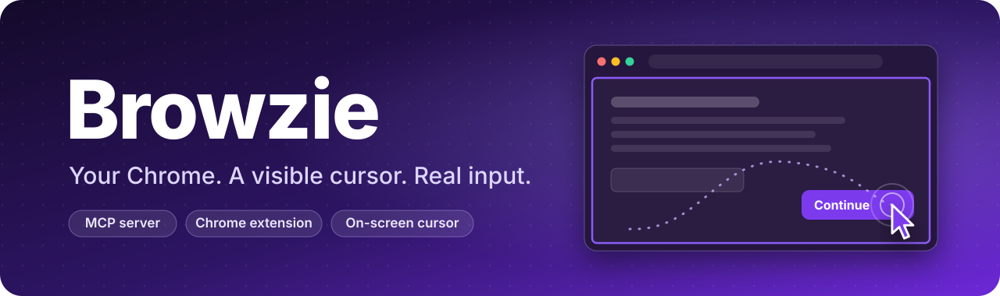
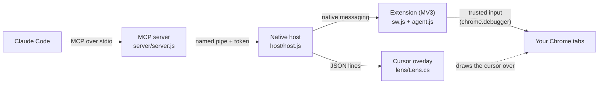

<p align="center">
  
</p>

<p align="center">
  <b>Let Claude Code use your everyday Chrome the way you do:<br>a cursor you can watch, real clicks and keystrokes, and the logins you already have.</b>
</p>

<p align="center">
  
  
  
  
  
  <a href="LICENSE"></a>
</p>

<p align="center">
  <a href="#-quick-start">Quick start</a> ·
  <a href="#-how-it-works">How it works</a> ·
  <a href="#-tools">Tools</a> ·
  <a href="#-configuration">Configuration</a> ·
  <a href="#-testing">Testing</a> ·
  <a href="DESIGN.md">Design document</a>
</p>

---

## ✨ Why Browzie

Most browser agents start a separate, flagged browser and look at it through screenshots. Browzie
works the other way round. It lives in **the Chrome you already use**, talks to Claude Code over a
local pipe in about **2 ms**, reads pages as compact text instead of pictures, and acts with
**real, trusted mouse and keyboard input** that you can watch happen on screen.

<table>
  <tr>
    <td width="50%" valign="top">
      <h4>🖱️ A cursor you can watch</h4>
      A native overlay draws a purple arrow exactly where Chrome receives the pointer (0.00 px error,
      measured), with a ripple on every click and a thin frame around the page in use.
    </td>
    <td width="50%" valign="top">
      <h4>🔐 Your browser, your logins</h4>
      Runs as an extension in your normal Chrome profile. No relaunch, no debugging port, no copied
      cookies and no API keys.
    </td>
  </tr>
  <tr>
    <td valign="top">
      <h4>⚡ Fast where it counts</h4>
      A zero-dependency chain of stdio, a named pipe and native messaging. Snapshots and diffs
      instead of screenshots, and <code>batch</code> runs a whole flow in one model turn.
    </td>
    <td valign="top">
      <h4>🧍 Real input with a human shape</h4>
      Trusted events through <code>chrome.debugger</code>: curved Fitts' law movement, separate
      button and key down/up events, Shift as its own key, whole wheel notches.
    </td>
  </tr>
  <tr>
    <td valign="top">
      <h4>🛑 CAPTCHAs go to you</h4>
      Bot checks are detected in every frame. Browzie stops, notifies you and waits. It never
      solves, clicks or works around a challenge.
    </td>
    <td valign="top">
      <h4>🧑‍💻 Works beside you</h4>
      It never steals the focus, so you can keep working in other windows. Click or type in its
      window and it hands control back to you at once.
    </td>
  </tr>
  <tr>
    <td valign="top">
      <h4>🫥 No trace in the page</h4>
      Nothing is injected into the page's DOM, the page agent is read-only, and no extension file
      is reachable from a site. No user-agent, fingerprint or IP tricks.
    </td>
    <td valign="top">
      <h4>🔑 Passwords stay yours</h4>
      <code>signin</code> lets you pick a saved login from Chrome's own list. Browzie never types,
      reads or sees a password.
    </td>
  </tr>
</table>

## 🚀 Quick start

**You need:** Windows 10 or 11, [Node.js](https://nodejs.org) 20 or newer, Google Chrome and the
[Claude Code](https://docs.anthropic.com/en/docs/claude-code) CLI.

```bash
git clone https://github.com/theyashdhiman04/Browzie.git
cd Browzie
node scripts/install.js
```

The installer:

1. builds the cursor overlay with the `csc.exe` compiler that ships with Windows (nothing is downloaded),
2. registers the native messaging host for your Windows account only (`HKCU`),
3. adds the MCP server `browzie` to Claude Code (user scope).

Then load the extension once:

1. open `chrome://extensions` in your everyday Chrome,
2. switch on **Developer mode** (top right),
3. click **Load unpacked** and pick the `extension` folder.

Restart Claude Code and ask, for example:

> Use browzie to open news.ycombinator.com and tell me the top 3 stories.

| Command | What it does |
|---|---|
| `npm run check` | diagnoses an installation step by step |
| `node scripts/install.js --remove` | undoes everything the installer did |
| `node scripts/install.js --no-mcp` | skips the Claude Code registration (for other MCP clients) |

> [!TIP]
> Any MCP client that speaks stdio can use Browzie: point it at `node <path>/Browzie/server/server.js`.

## 🧭 How it works



| Piece | Role |
|---|---|
| **MCP server** | Zero-dependency JSON-RPC over stdio. One process per Claude Code session, one Browzie window per session. |
| **Native host** | Started by Chrome. Joins Claude Code sessions to the browser through a named pipe with a 192-bit token, so nothing listens on the network. |
| **Extension** | The service worker plans and sends input. The page agent runs in an isolated world and only reads: snapshots, refs, hit tests, geometry and bot-check detection. |
| **Cursor overlay** | A click-through, never-focused native window that draws the cursor, the page frame and handoff banners, and notices when you take over. |

One click, end to end: Claude asks for `click {ref: "e12"}`, the extension checks for bot checks
and dialogs, asks the page agent for an aim point (wheel-scrolling it into view if needed), moves
the pointer along a planned curve while the overlay mirrors it, checks the target is still under
the pointer, presses and releases, waits for the page to settle and returns a diff of what changed.
The full design, with the measurements behind every decision, is in **[DESIGN.md](DESIGN.md)**.

## 👀 What you will see

- **Its own window** with a purple tab group named **Claude**, so your own tabs stay untouched.
  Tabs and popup windows the page opens (a "sign in with..." window) are followed automatically.
- **A purple cursor** gliding over the page with a ripple on each click, and a thin frame around
  the page it is working on. Both show only while Browzie acts on that tab.
- **Chrome's own bar** saying that "Browzie for Claude Code" started debugging this browser.
  Clicking **Cancel** there pauses Browzie.
- **The toolbar button** pauses and resumes everything. During a handoff it means "Done".
- **Bot checks and two-factor codes** bring up a banner and a notification. Solve it (or click
  Done) and Claude carries on by itself.

> [!NOTE]
> Keep at least part of the Browzie window visible, for example snapped beside your work or on a
> second screen. Chrome treats the pages of a fully covered window as hidden, and a hidden page
> receiving clicks is something no person can do, so Browzie waits and tells you.

## 🧰 Tools

| Tool | What it does |
|---|---|
| `navigate` | open a URL, go back, forward or reload, or open a new tab; returns a snapshot |
| `snapshot` | compact page text with refs like `[e12]` (`f1e3` inside iframes) |
| `find` · `read` | search elements or read text across all frames |
| `screenshot` | the viewport in CSS pixels, optionally with ref labels drawn on |
| `click` · `hover` | move the cursor to an element and click or rest; wheel-scrolls it into view first |
| `fill` | many fields at once: text, checkbox, radio, select, date, slider and file inputs |
| `type` · `press` | real keystrokes and shortcuts; long text goes in word chunks and can resume |
| `scroll` | the mouse wheel, by amount, to an edge, or until a ref is in view |
| `wait_for` | text, a selector, a URL, their disappearance, or a button becoming enabled |
| `upload` | answers the file chooser a button or input opens (the Windows dialog never appears) |
| `dialog` | accepts or dismisses alert, confirm and prompt dialogs |
| `tabs` | lists, opens, switches and closes Browzie's tabs and followed popups |
| `signin` | you pick a saved login in Chrome's list; Browzie presses the button |
| `handoff` | hands control to you and waits (CAPTCHA, 2FA, payment) |
| `evaluate` | JavaScript in an isolated world (default) or the page's own world |
| `batch` | several of the steps above in one call |

Input tools return only what changed on the page. `snapshot: "none"` returns a single line for
steps you will verify another way.

## ⏱️ Speed

Measured with `npm run bench` (headless Chrome for Testing, local pages, medians of 15 runs):

| Operation | Time |
|---|---:|
| round trip through every hop | 2 ms |
| snapshot of a form page | 4 ms |
| find / read | 3 ms / 2 ms |
| snapshot through 3 iframes (2 cross-site, 1 nested) | 12 ms |
| viewport screenshot | 58 ms |
| navigate + snapshot | about 0.4 s |

Input speed is a setting, `BROWZIE_PACE`:

| Pace | Feels like | Pointer move | Typing |
|---|---|---|---|
| `fast` (default) | a quick, confident user | 45 to 250 ms | keystrokes; text over 40 characters in word chunks |
| `brisk` | a practised user | Fitts' law, shorter | key by key, quicker rhythm |
| `human` | a careful person | Fitts' law, up to 1.7 s | key by key with natural pauses, optional typos that get corrected |

## ⚙️ Configuration

Set these in the environment of the MCP server (for example with `claude mcp add -e`):

| Variable | Meaning |
|---|---|
| `BROWZIE_PACE` | `fast` (default), `brisk` or `human` |
| `BROWZIE_YIELD` | `window` (default): stop only for your input in the Browzie window; `any`: stop for any input anywhere; `off`: never stop |
| `BROWZIE_DESKTOP` | the virtual desktop for Browzie's windows (number or GUID, or `off`); default: the desktop Claude Code runs on |
| `BROWZIE_CHROME_PATH` | the `chrome.exe` to start when Chrome is not running |
| `BROWZIE_DEBUG=1` | timing lines on stderr |
| `BROWZIE_LENS_LOG` | a file the cursor overlay writes its window decisions to |

The native host logs to `%LOCALAPPDATA%\Browzie\host.log`.

## 🛡️ Principles

Browzie makes automation look like what it really is underneath, a careful session in a real
browser, and removes the artificial tells that tools add. It does not lie about anything.

**It never:**

- changes the user agent, client hints, `navigator`, WebGL, canvas, fonts, timezone, language or screen values,
- patches page functions or uses stealth plugins,
- uses proxies or rotates IP addresses,
- runs headless against real sites,
- solves, clicks into or bypasses a CAPTCHA or bot check.

What it does instead: real input in your own profile, human-shaped timing, per-site rate caps, and
a handoff to you whenever a site asks for a person. No tool can promise that an account is never
flagged, and some sites forbid automation in their terms, so use it where you are allowed to.

## 🧪 Testing

```bash
npm test                    # unit tests for the motion and timing model + end-to-end tests
npm run footprint           # 22 checks of what a bot-detection script on the page can observe
npm run bench               # the latency table above
npm run lens-check          # the drawn cursor tip vs. where Chrome delivers the pointer
npm run takeover-check      # keeps working while you type elsewhere, yields in its own window
npm run desktop-check       # windows stay on their virtual desktop and never take the focus
npm run live                # real sites: bot.sannysoft.com, deviceandbrowserinfo.com, Wikipedia
```

End-to-end tests drive a throwaway **Chrome for Testing** profile, because branded Chrome no
longer accepts `--load-extension`. Install it with `npx @puppeteer/browsers install chrome@stable`
and register the host for it once with `node scripts/install.js --no-mcp --test-browsers`.
Nothing touches your own profile.

## 📁 Project layout

```
Browzie/
├── extension/        Chrome extension (Manifest V3)
│   ├── manifest.json
│   ├── sw.js         service worker: sessions, input executor, safety gates
│   ├── agent.js      read-only page agent (isolated world)
│   ├── lib/          human.js (motion and timing), keys.js, diff.js
│   └── icons/
├── host/host.js      native messaging host and named-pipe hub
├── lens/Lens.cs      on-screen cursor overlay (built to browzie-lens.exe)
├── server/server.js  MCP server
├── scripts/          install.js, make-icons.js
├── test/             unit, end-to-end, footprint, bench and overlay checks, fixtures
└── DESIGN.md         architecture and measurements
```

## 🗺️ Roadmap

- [ ] macOS and Linux overlays (the host already handles Unix sockets)
- [ ] a Chrome Web Store listing, so the extension loads without Developer mode
- [ ] learn your own wheel step and typing speed from your real input
- [ ] typo model for keyboard layouts other than US

## 📄 License

[MIT](LICENSE) © 2026 Yash Dhiman
